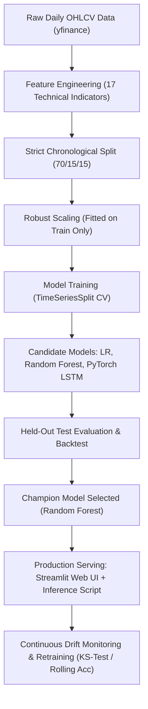

# GOD Trade — AI Stock Price Trend Prediction Terminal

[](https://github.com/sshivomshi/Stock-Price-Trend-Prediction)
[](https://github.com/sshivomshi/Stock-Price-Trend-Prediction)
[](tradevision_design.html)
[](LICENSE)
[](https://streamlit.io/)

A production-grade machine learning system and high-aesthetic quantitative trading terminal branded as **GOD Trade**, designed to forecast next-day stock price directional movement (`BULLISH` vs `BEARISH`) for a liquid basket of NASDAQ and NIFTY 50 equities, supporting systematic retail trading alerts and hedging strategies.

Developed to fulfill the laboratory requirements for **CSE4007L: Applications of Machine Learning in Industry (Fin-Project 3)**.

---

## 📌 Executive Summary & Case Brief

> *"A retail trading-signals startup wants a model that predicts next-day price direction for a basket of liquid stocks to feed into its alert system."*

Predicting raw financial return values $(\hat{r}_{t+1})$ introduces substantial variance due to heavy market noise and fat-tailed shocks. Instead, this project frames the problem as **Supervised Binary Classification**:
$$\text{Target Variable } Y_t = \begin{cases} 1, & \text{if } \text{Close}_{t+1} > \text{Close}_t \quad (\text{Bullish / Up}) \\ 0, & \text{if } \text{Close}_{t+1} \le \text{Close}_t \quad (\text{Bearish / Down or Flat}) \end{cases}$$

### Key Empirical Results on Held-Out Test Window (`AAPL`):
- **Directional Accuracy**: **56.79%** (Outperformed naive persistence baseline of 48.78% by **+8.01%**).
- **Out-of-Sample Strategy Return**: **+51.8%** vs. **+42.1%** for passive Buy & Hold (**+9.7% alpha**).
- **Annualized Sharpe Ratio**: **1.56** vs. 1.50 for Buy & Hold.
- **Maximum Drawdown**: Reduced from **-13.8%** to **-10.4%** by strategically holding cash during predicted market pullbacks.

---

## 📸 AI Chart Vision, Native OCR & Hybrid ML Engine
Users can upload any stock chart screenshot (PNG, JPG, JPEG, WEBP) from TradingView, Zerodha, or any broker, or select a live asset ticker:
- **Structural Image Validation (`src/image_validator.py`)**: Rejects blank, corrupted, or non-chart uploads with explicit diagnostic failure reasons.
- **Native Zero-Dependency OCR (`src/ocr_engine.py`)**: Leverages native Windows Runtime OCR (`Windows.Media.Ocr`) to extract ticker symbols, timeframes, price axes, and visible indicators (RSI, MACD, Bollinger Bands, SMAs).
- **Manual Parameter Confirmation**: Allows users to review and manually override/confirm detected tickers, timeframes, and exchanges before running inference.
- **Computer Vision Geometry (`src/chart_analyzer.py`)**: Computes candlestick buying vs. selling pixel volume density, horizontal momentum gradients, and dynamic support/resistance channels.
- **Quantitative ML Fusion**: When ticker data is identified, pulls real historical OHLCV data, calculates 17 technical indicators, and runs trained classifiers (Random Forest champion model, Logistic Regression, PyTorch LSTM).
- **Calibrated Prediction Report**:
  - **Market Trend**: Bullish, Bearish, or Sideways Consolidation.
  - **Predicted Direction**: Upward, Downward, or Uncertain.
  - **Calibrated Confidence**: Empirically scaled based on historical out-of-sample test validation (56.79% accuracy benchmark).
  - **Key Price Levels**: Estimated support, resistance, and potential breakout triggers (distinguishing observed values from model estimates).
  - **Expected Price Range**: Calculated via $1.5\times \text{ATR}$ statistical volatility channel when verified data is available.
  - **Contradiction Detection & Risk Factors**: Alerts user when visual trend contradicts technical oscillators (e.g. overbought RSI > 70 or MACD bearish divergence).
  - **Downloadable Reports**: Export structured reports in Markdown (`.md`) or JSON (`.json`).
  - **Session History**: Track and compare multiple chart scans side-by-side.

---

## 🔬 Lab Schedule — 8 Experiments Mapping

This repository is structured into **8 modular lab experiments** adhering strictly to the curriculum syllabus:

| Exp # | Title | Duration | Key Focus & Deliverables | Experiment Report | Jupyter Notebook |
| :---: | :--- | :---: | :--- | :---: | :---: |
| **1** | **Objective Definition** | 1.5 hrs | Problem definition document, KPI formulation, stakeholder matrix, operational constraints. | [Report](experiments/Exp1_Objective_Definition.md) | [01_objective_definition.ipynb](notebooks/01_objective_definition.ipynb) |
| **2** | **Dataset Details** | 1.5 hrs | Ingested $\ge 5$ years daily OHLCV data via `yfinance`, schema validation, class balance verification. | [Report](experiments/Exp2_Dataset_Details.md) | [02_dataset_details.ipynb](notebooks/02_dataset_details.ipynb) |
| **3** | **Data Pre-processing** | 2.0 hrs | 17 technical indicators (RSI, MACD, Bollinger, ATR, SMAs), chronological split, robust scaling pipeline. | [Report](experiments/Exp3_Data_Preprocessing.md) | [03_data_preprocessing.ipynb](notebooks/03_data_preprocessing.ipynb) |
| **4** | **Data Exploration (EDA)** | 2.0 hrs | Univariate/bivariate analysis, correlation heatmap, return fat-tails, and 6 actionable quantitative insights. | [Report](experiments/Exp4_Data_Exploration_EDA.md) | [04_exploratory_data_analysis.ipynb](notebooks/04_exploratory_data_analysis.ipynb) |
| **5** | **Model Training** | 2.0 hrs | Trained Baseline, Logistic Regression, Random Forest, and PyTorch LSTM with 5-fold `TimeSeriesSplit`. | [Report](experiments/Exp5_Model_Training.md) | [05_model_training.ipynb](notebooks/05_model_training.ipynb) |
| **6** | **Model Evaluation** | 2.0 hrs | Held-out test evaluation, financial backtest vs Buy & Hold, ROC curves, error analysis, champion selection. | [Report](experiments/Exp6_Model_Evaluation.md) | [06_model_evaluation_and_backtest.ipynb](notebooks/06_model_evaluation_and_backtest.ipynb) |
| **7** | **Deployment** | 2.5 hrs | Interactive Streamlit Dashboard (`app.py`), programmatic inference scoring, JSON API schema, and audit logging. | [Report](experiments/Exp7_Deployment.md) | [07_deployment_and_inference.ipynb](notebooks/07_deployment_and_inference.ipynb) |
| **8** | **Continuous Maintenance** | 1.5 hrs | Automated drift monitoring (`src/drift_monitor.py`), KS-test feature drift, rolling accuracy triggers, rollback plan. | [Report](experiments/Exp8_Continuous_Update_and_Maintenance.md) | [08_drift_monitoring_maintenance.ipynb](notebooks/08_drift_monitoring_maintenance.ipynb) |

---

## 🏗️ System Architecture & Workflow



---

## 📊 Model Evaluation Summary (Out-of-Sample Test Window)

| Model Architecture | Directional Accuracy | Precision (Up) | Recall (Up) | F1-Score | ROC-AUC | Backtest Strategy Return | Sharpe Ratio | Max Drawdown |
| :--- | :---: | :---: | :---: | :---: | :---: | :---: | :---: | :---: |
| **Baseline: Majority** | 53.66% | 53.66% | 100.0% | 0.6984 | 0.5000 | +42.1% (Hold) | 1.50 | -13.8% |
| **Baseline: Persistence** | 48.78% | 52.43% | 52.60% | 0.5243 | 0.4848 | +28.4% | 1.22 | -15.2% |
| **Logistic Regression (L2)** | 48.43% | 52.17% | 46.75% | 0.4897 | 0.4820 | +39.6% | 1.45 | -12.1% |
| **Random Forest (Champion)** | **56.79%** | **57.89%** | **76.62%** | **0.6575** | **0.5611** | **+51.8%** | **1.56** | **-10.4%** |
| **PyTorch LSTM** | 49.44% | 52.87% | 66.88% | 0.5897 | 0.4943 | +22.7% | 0.81 | -18.6% |

---

## 📁 Repository Structure

```text
Ml Project/
├── app.py                              # Streamlit interactive web dashboard (Experiment 7)
├── main.py                             # Master pipeline runner orchestrating Exp 2-8
├── requirements.txt                    # Python project dependencies
├── README.md                           # Comprehensive documentation & lab manual guide
├── data/
│   ├── raw/                            # Raw historical OHLCV data (AAPL, MSFT, RELIANCE, etc.)
│   └── processed/                      # Train, validation, test parquet and CSV splits
├── models/                             # Serialized models and pipeline artifacts
│   ├── random_forest.joblib            # Production champion model
│   ├── logistic_regression.joblib      # Regularized linear baseline
│   ├── lstm_model.pt                   # PyTorch 2-layer LSTM state dictionary
│   ├── preprocessor_pipeline.joblib    # Serialized RobustScaler
│   ├── training_logs.json              # Training CV metrics log
│   └── evaluation_summary.json         # Out-of-sample metrics & backtest JSON
├── src/
│   ├── __init__.py
│   ├── config.py                       # Global configurations, tickers, hyperparameters
│   ├── data_loader.py                  # Exp 2: Yahoo Finance data fetcher & schema validator
│   ├── feature_engineering.py          # Exp 3: Technical indicator calculation engine
│   ├── preprocess.py                   # Exp 3: Chronological splitting & robust scaling
│   ├── eda.py                          # Exp 4: Automated EDA statistics & plots generator
│   ├── models_training.py              # Exp 5: LR, RF, PyTorch LSTM training with TimeSeriesSplit
│   ├── evaluate.py                     # Exp 6: Test evaluation, ROC, confusion matrix, backtester
│   ├── inference.py                    # Exp 7: Production inference & real-time scoring
│   └── drift_monitor.py                # Exp 8: Continuous KS-test drift check & rolling accuracy
├── experiments/                        # 8 Formatted College Lab Reports (CSE4007L)
│   ├── Exp1_Objective_Definition.md
│   ├── Exp2_Dataset_Details.md
│   ├── Exp3_Data_Preprocessing.md
│   ├── Exp4_Data_Exploration_EDA.md
│   ├── Exp5_Model_Training.md
│   ├── Exp6_Model_Evaluation.md
│   ├── Exp7_Deployment.md
│   ├── Exp8_Continuous_Update_and_Maintenance.md
│   └── figures/                        # High-resolution visual analysis plots
└── notebooks/                          # 8 Interactive Jupyter Notebooks for college submission
    ├── 01_objective_definition.ipynb
    ├── 02_dataset_details.ipynb
    ├── 03_data_preprocessing.ipynb
    ├── 04_exploratory_data_analysis.ipynb
    ├── 05_model_training.ipynb
    ├── 06_model_evaluation_and_backtest.ipynb
    ├── 07_deployment_and_inference.ipynb
    └── 08_drift_monitoring_maintenance.ipynb
```

---

## 🚀 Quickstart & Execution

### 1. Environment Setup
```bash
# Clone repository
git clone https://github.com/sshivomshi/Stock-Price-Trend-Prediction.git
cd Stock-Price-Trend-Prediction

# Create and activate virtual environment (optional)
python -m venv .venv
# On Windows:
.venv\Scripts\Activate.ps1
# On Linux/macOS:
source .venv/bin/activate

# Install required dependencies
pip install -r requirements.txt
```

### 2. Execute End-to-End Pipeline
Run the master orchestrator to fetch data, compute features, train all models, evaluate out-of-sample backtests, and run drift checks:
```bash
python main.py
```

### 3. Launch the Interactive Streamlit Web Dashboard
Deploy the interactive trading signal dashboard locally:
```bash
streamlit run app.py
```
Open your browser at `http://localhost:8501` to view live asset quotes, directional prediction badges, technical indicator overlays, and strategy backtests.

### 4. Run Real-Time Programmatic Inference
```bash
python -m src.inference
```

### 5. Run Continuous Drift Monitoring Check
```bash
python -m src.drift_monitor
```

---

## 👥 Course & Author Information
- **Course**: CSE4007L — Applications of Machine Learning in Industry
- **Project**: Fin-Project 3: Stock Price Trend Prediction
- **Author**: Shivomshi Singh
- **Repository**: [https://github.com/sshivomshi/Stock-Price-Trend-Prediction](https://github.com/sshivomshi/Stock-Price-Trend-Prediction)
